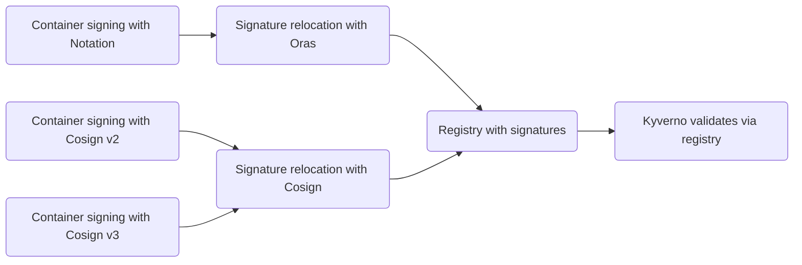
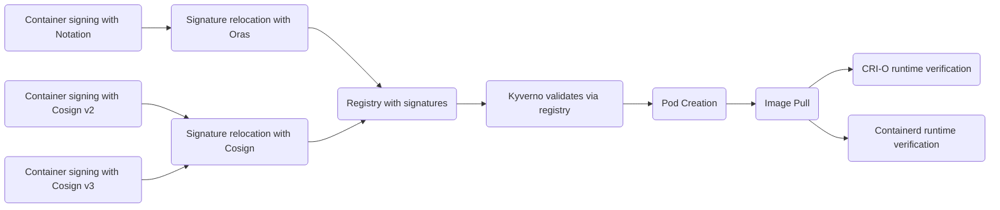
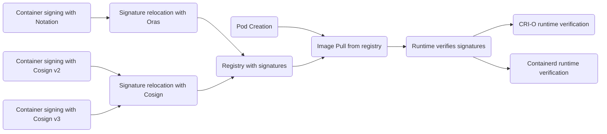

# Container Signing POC
<!-- cSpell:ignore kyverno,oras,sigstore,rebranded,pkcs,fulcio,rekor -->
<!-- cSpell:ignore containerd,referrers -->

This repository continues the 2024 POC in
[Nordix/metal3-clusterapi-docs](https://github.com/Nordix/metal3-clusterapi-docs/tree/main/security/container-signing-poc);
history before 2025-09-26 is there.

This experiment has multiple parts and options:

1. Image signing:

   - [Signing images with Notation, especially with custom signers](notation/README.md)
   or
   - [Signing with Cosign v2 (external signer)](cosign-v2/README.md)
   or
   - [Signing with Cosign v3 (native signing)](cosign-v3/README.md)
   or
   - [Signing with Cosign v4-pre (new bundle format only)](cosign-v4-pre/README.md)

1. Signature relocation:

   - [Moving signatures from one registry to another with Oras](oras/README.md)
   or
   - Moving Cosign signatures from one registry to another with Cosign

1. Admission controller verification:

   - [Validating the signing with Kyverno admission controller](kyverno/README.md)

1. Container runtime verification:

   - [CRI-O](crio/README.md)
   or
   - [Containerd](containerd/README.md)

## Flow with Kyverno admission controller

## Flow with Kyverno and container runtime verification both

## Flow with container runtime verification

## TL;DR of the POC

Basically, the POC is finding the following:

### Notation

1. Notation is extendable with their plugin system
1. Plugin that can call any external script or binary to produce a signature has
   been implemented.
1. This allows any in-house, custom integration to private signer, regardless
   of the interface, even manual/email works (despite being brittle), without
   writing a full-fledged plugin with Go.
1. Notation can handle SHA512 with PSS, no problem
1. Kyverno verifies Notation signatures at admission with an
   `ImageValidatingPolicy`.
1. Oras can be used to move containers and signatures from CI to production

### Cosign

1. Cosign does not need plugins as it can be operated via command line to
   achieve external signing (v2) or use native signing (v3).
1. Cosign v2 uses external signer + `cosign attach signature` for legacy format
1. Cosign v3 uses native `cosign sign --key` for new bundle format
1. Both v2 and v3 use same CA-based certificate verification
1. Cosign can also save and load images with signatures by itself, Oras is not
   needed
1. The Cosign ecosystem restricts signatures to the algorithms in sigstore's
   [algorithm registry](https://github.com/sigstore/sigstore/blob/main/pkg/signature/algorithm_registry.go):
   RSA PKCS#1 v1.5 (2048/3072/4096) with SHA-256, and ECDSA P-256, P-384 and
   P-521. RSA-PSS and SHA-512-with-RSA are excluded, as Sigstore keeps support
   homogeneous across its services. The v4-pre POC signs with ECDSA P-384 and
   SHA-384, so the earlier claim that only SHA-256 with RSA PKCS#1 works was
   wrong.
1. Kyverno verifies legacy Cosign signatures the same way as Notation, with
   transparency log and SCT checks disabled in the policy.
1. Kyverno 1.20 rejects and no longer runs `kyverno.io` `ClusterPolicy`; all
   policies here are `policies.kyverno.io/v1` `ImageValidatingPolicy`.

### Cosign v4-pre (new bundle format only)

Anticipating cosign v4, where Sigstore bundles (v0.3+) become the only format
and the legacy `cosign attach` path is removed. Each finding names the target
that asserts it; `make cosign-v4-pre` runs them all.

| Finding | Asserted by |
| -- | -- |
| Signing with a private PKI works: the bundle carries leaf + intermediate while the trust anchor is the root alone. [cosign#3976](https://github.com/sigstore/cosign/issues/3976) is fixed on the bundle codepath as of cosign 3.1.3; the legacy path is still affected | `cosign-v4-pre` `test`; `cosign-v3` `repro-3976-legacy` |
| Verification requires `--allow-certificate-chain`; without it cosign falls back to the legacy path and reports `no signatures found` | `cosign-v4-pre` `test` |
| External signing works without `cosign attach`: a `sigstore-kms-*` plugin keeps the key from cosign, or the bundle is built and published entirely without cosign (openssl plus `oras attach`), asynchronously | `cosign-v4-pre` `v4-external-plugin`, `v4-external-offline` |
| The production algorithm, an RSA 4096 leaf with PKCS#1 v1.5 and SHA-256 and a URI SAN, works end to end without cosign at signing time: timestamp, bundle, relocation, Kyverno, containerd verifier | `cosign-v4-pre` `v4-rsa`; `kyverno` `cosign-v4-pre.mk SIGN_TARGET=v4-rsa`; `containerd` test 7 |
| Kyverno admits a private-PKI bundle in one shape only: leaf alone, intermediate in the trusted root, RFC 3161 timestamp. Leaf plus intermediate is denied with `no signatures found`, a leaf without timestamp with `threshold not met for verified signed timestamps` | `kyverno` `cosign-v4-pre.mk`, `bundle-shapes.mk` |
| With `mutateDigest` and `verifyDigest` off Kyverno admits a tag reference unchanged; by default it rewrites it to `tag@digest` | `kyverno` `cosign-v4-pre.mk DIGEST=false` |
| Bundles relocate with `oras cp -r` through an OCI layout tarball. `cosign save` and `load` carry them too, in a layout only `cosign load` reads | `cosign-v4-pre` `v4-relocate`, `v4-save-load` |
| On `registry:3` bundles are found through the fallback tag, on zot through the referrers API; signing, verification, relocation and admission work on both | `cosign-v4-pre` `v4-referrers`; `kyverno` `bundle-zot.mk` |
| A development bundle next to the production one is harmless: a trusted root without the development CA admits on the production bundle. Deleting it before export, or signing in a clean promotion repository, leaves the production bundle alone | `cosign-v4-pre` `v4-dev-signatures`; `kyverno` `bundle-dev.mk` |
| One trusted root holds two CA generations with validity windows; dropping one, or closing its window, fails its signatures | `cosign-v4-pre` `v4-rotation` |
| A timestamped bundle outlives its leaf: after the leaf expires it still verifies and Kyverno admits it; an untimestamped bundle fails | `cosign-v4-pre` `v4-leaf-expiry`; `kyverno` `bundle-expiry.mk` |
| A bundle covers one digest. On a multi-arch image, a bundle on the index admits pulls by tag, not by platform digest, in Kyverno and in the containerd verifier alike; sign the index and the platform manifests | `cosign-v4-pre` `v4-multiarch`; `kyverno` `bundle-multiarch.mk`; `containerd` tests 8 to 11 |
| The containerd verifier, a `cosign verify` wrapper, verifies bundles against a trusted root, but is skipped on the CRI local pull path, `use_local_image_pull = true`, that a decrypting node needs | `containerd` tests 5 to 7, 12 |
| CRI-O cannot verify a bundle-only image through `policy.json` ([container-libs#388](https://github.com/podman-container-tools/container-libs/issues/388)) | `crio` test 5 |
| The signing certificate needs an email or URI SAN: cosign 3.x takes identities from SANs only | `cosign-v4-pre` `v4-san-required` |
| Kyverno 1.20 refuses to create a `ClusterPolicy`; `ImageValidatingPolicy` `v1` and `v1beta1` are interchangeable | `kyverno` `api-versions` |
| `sign-offline.sh` is the cosign-free signing entry point for other repositories: any image by digest, registry and key material, from any directory; its interface is in [cosign-v4-pre](cosign-v4-pre/README.md) | `crio` `sign-image-bundle-only`, with the CRI-O PKI from that directory; `cosign-v4-pre` `v4-tls` on a TLS registry; every bundle target with its own material |
| Cosign main removes `cosign attach signature`, so the legacy external-signer flow fails there | `make tripwire-cosign-main` |

Registries other than the local `registry:3` and zot are not covered.

## Runtime-Level Verification

1. CRI-O 1.34+ has built-in signature verification support via policy.json
1. Containerd 2.1+ can verify signatures at runtime via Transfer Service API

Both could also verify signatures using OCI hooks, with cost of performance hit
on each container creation. This would allow malicious, unsigned images hit the
local disk, which is not ideal either.

## e2e test

Run from this directory: `make notation`, `make cosign-v2`, `make cosign-v3`,
`make cosign-v4-pre`, then `make clean`. `make tripwire-cosign-main` builds
cosign main at a pinned commit, into `build/`, and needs Go.

Each signs in a build registry, relocates the image with its signatures into
the Kind registry, applies the Kyverno policy, and fails unless the unsigned
pod and deployment are denied and the signed ones are admitted and running.
`make cosign-v4-pre` also runs the bundle signing flows standalone and every
bundle Kyverno flow. See [kyverno/README.md](kyverno/README.md).

### CRI-O and containerd e2e tests

These install and configure container runtimes system-wide, so they run in
disposable QEMU VMs: `make -C vm crio` and `make -C vm containerd` start an
Ubuntu 24.04 VM, copy the directory and `cosign-v4-pre` in, run `make setup`,
reboot, and run `make test`. No root on the host; state is under `build/vm`,
removed by `make -C vm clean`. On an existing VM, run `make setup`, reboot,
`make test` in the directory.

## Notes

### Notes on Notation

Notary V1 was part of TUF (The Update Framework) organization, yet separate
project in CNCF. Notary V2 has been rebranded as Notation to make the branding
clearer that it is based on different principles than Notary V1. Notary V1/TUF
has more strict "security principles", which also made it hard to use, and it
did not gain traction.

It should be noted that Notary V1 and Notary V2/Notation are completely different
projects, with claims of [hostile takeover](https://github.com/cncf/toc/issues/981)
by the new maintainers (Microsoft/Docker). CNCF TOC did not see it that way,
but funded a
[security audit](https://www.cncf.io/blog/2023/07/11/announcing-results-of-notation-security-audit-2023/)
for Notation, with no critical findings, but the argument from the Notary V1
folks is that the foundation of Notation security model is not good enough. This
design aspect was not part of the audit based on the findings.

### Notes on Kyverno

Kyverno 1.20 verifies images only through `ImageValidatingPolicy`
(`policies.kyverno.io`); the legacy `verifyImages` rules in `ClusterPolicy` are
no longer executed. It verifies both Notation and Cosign signatures.

Kyverno is generic policy engine, capable of replacing OPA Gatekeeper etc.

### Notes on Oras

Oras can handle any OCI binary or blob perfectly fine. For legacy Cosign
signatures `cosign save`/`load` is enough. They carry Sigstore bundles too,
but in a layout only `cosign load` reads; `oras cp -r` moves bundles through a
standard OCI layout, so Oras is the transport for bundles here.

### Notes on Cosign

While other components here are CNCF projects, Cosign is OpenSSF project. It is
developed on top of TUF framework, and is more of a continuation to Notary v1
than Notary v2/Notation ever was. Sigstore ecosystem contains not only Cosign,
but also Rekor and Fulcio for certificate management and transparency log servers,
as well as support for many languages, like Go, Python, Ruby, Java etc. This is
a strength and a weakness the same time, as mentioned before related to SHA256
hardcoding problem.

### Notes on CRI-O

CRI-O requires version 1.34+ for built-in signature verification support via
policy.json. The support comes from the underlying containers/image library, which
has had signature verification support since February 2025.

### Notes on Containerd

Containerd's Transfer Service API based image verification is a new feature
added in version 2.1+. It allows pluggable verifiers to be used during
image pulls, to verify signatures or do other checks before allowing the image
to be used.
