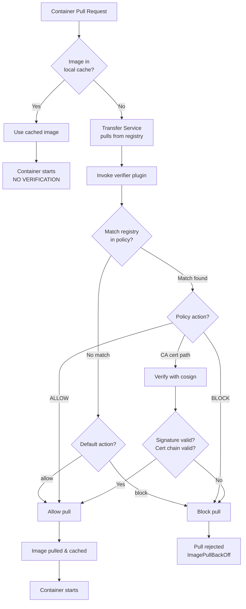

# Containerd Transfer Service Signature Verification

<!-- markdownlint-configure-file { "MD013": { "tables": false } } -->

Runtime signature verification using containerd 2.1+ Transfer Service with
BYO-PKI certificates (X.509).

Run it in a VM with `make -C ../vm containerd`.

## This is THE Official Approach

This implementation uses containerd's **official image verification plugin**
system (`io.containerd.image-verifier.v1.bindir`), which:

- Was merged in [PR #8493](https://github.com/containerd/containerd/pull/8493)
  (Sept 2023)
- Works with CRI since
  [PR #8515](https://github.com/containerd/containerd/pull/8515) (Apr 2025,
  containerd 2.1)
- Is the same approach used by
  [ratify-containerd](https://github.com/notaryproject/ratify-containerd)
  (Notary Project's PoC)
- Is documented in
  [containerd image-verification.md](https://github.com/containerd/containerd/blob/main/docs/image-verification.md)

**Roadmap Status (Nov 2025):**

- Transfer Service image verifier - available since containerd 2.0
- CRI uses Transfer Service by default - containerd 2.1+
- Cache bypass limitation - known, unlikely to change (by design)

## Known Limitation

**Transfer Service verifiers only run on registry pulls, NOT on cached images.**

This means:

- Cached images bypass verification
- Pre-loaded images run without checks
- `ctr image import` bypasses verification
- The CRI local pull path, `use_local_image_pull = true`, bypasses it too
  (test 12)

**For production:** Use admission controllers (Kyverno, Ratify) as primary
control. Transfer Service is defense-in-depth only.

See [containerd issue #10768](https://github.com/containerd/containerd/issues/10768)
for discussion on this limitation.

## Requirements

- **containerd 2.1+** (Transfer Service + CRI integration)
- Ubuntu 24.04 VM with sudo

## Quick Start

```bash
make setup    # Install containerd 2.1+, k8s, docker, cosign (requires reboot)
# <reboot>
make run      # Install verifier, init k8s, sign images, run tests
make test-v2  # Test only v2 signatures
make clean    # Reset everything
```

## How It Works



**Note:** Cached images bypass verification entirely - this is a known limitation.

Containerd config (`/etc/containerd/config.toml`, from
`scripts/containerd-config-template.toml`): the `bindir` verifier runs every
executable in `bin_dir` on each Transfer Service pull, with `-name`,
`-digest` and `-stdin-media-type`, and rejects the pull unless all exit 0:

```toml
version = 3

[plugins.'io.containerd.image-verifier.v1.bindir']
  bin_dir = '/opt/containerd/image-verifier/bin'
  max_verifiers = 10
  per_verifier_timeout = '10s'
```

Verifier policy config (`/etc/containerd/image-verifier.conf`):

```bash
# Per-registry policies (regex patterns supported)
REGISTRY_POLICY_PRIMARY=127\.0\.0\.1:5000|/etc/containerd/certs/registry-primary-ca.crt
REGISTRY_POLICY_SECONDARY=127\.0\.0\.1:5001|ALLOW
REGISTRY_POLICY_GCR=gcr\.io|BLOCK

# Default action for unknown registries
VERIFY_DEFAULT_ACTION=allow
```

Policy enforces **6 scenarios**:

- `127.0.0.1:5000`: VERIFY legacy signatures with BYO-PKI
- `127.0.0.1:5002`: VERIFY Sigstore bundles against a trusted root
- `127.0.0.1:5004`: VERIFY Sigstore bundles from `../cosign-v4-pre`
- `127.0.0.1:5001`: ALLOW without verification
- `gcr.io`: BLOCK
- Default: ALLOW

Verifier is a bash script that validates signatures using
[sigstore/cosign](https://github.com/sigstore/cosign), and oras for bundles.

The trust path in a policy is either a root CA PEM, verifying legacy attached
signatures, or a Sigstore trusted root `.json`, verifying bundles (the only
format in cosign v4, see [../cosign-v4-pre](../cosign-v4-pre/README.md)):

```bash
REGISTRY_POLICY_BUNDLE=127\.0\.0\.1:5002|/etc/containerd/certs/registry-bundle-trusted-root.json
```

`make test` signs `127.0.0.1:5000/alpine:3.20.3` with a legacy signature and
`127.0.0.1:5002/alpine:3.20.3` into a bundle the way cosign v4 does (leaf
plus intermediate in the bundle, root in the trusted root), and pushes an
unsigned `alpine:unsigned` to both.

It also runs `../cosign-v4-pre` `v4-multiarch`, `v4-leaf-expiry` and
`v4-legacy-fallback` in the VM, which publish on `127.0.0.1:5004` the
production shape signed without cosign (RSA 4096 leaf, leaf-only bundle,
signed timestamp), two multi-arch copies, a timestamped bundle whose leaf has
expired, and an image with a legacy signature alone, and installs their
trusted root for that registry. A trusted root with timestamp authorities
makes the verifier require a signed timestamp and check the leaf at its time,
as Kyverno does.

Without a bundle on the image `cosign verify` 3.x verifies a legacy signature
instead, though `--trusted-root` and `--allow-certificate-chain` ask for
bundles, and `--use-signed-timestamps` does not require a timestamp on that
path. For a trusted root policy the verifier therefore lists the image's
bundle referrers with oras and verifies each against the digest with `cosign
verify-blob-attestation`, which has no legacy path, and refuses an image with
none (tests 6, 9, 10, 14) or with none for its digest (test 15). A root CA
policy keeps `cosign verify` of legacy signatures. oras reaches a registry
over plain http only when `VERIFY_PLAIN_HTTP` matches it, and takes
credentials from `VERIFY_REGISTRY_CONFIG`, as containerd runs the verifier
without `HOME`. A bundle larger than `VERIFY_MAX_BUNDLE_BYTES`, 1 MiB by
default, is refused before cosign sees it.

Every image is removed from the node first, so each pod pulls, and each test
but 12 requires the verifier's log line for the image, on the expected digest:

| Test | Image | Result |
| -- | -- | -- |
| 1 | legacy signature on `127.0.0.1:5000` | runs, `PASSED` |
| 2 | unsigned on `127.0.0.1:5000` | blocked, `no signatures found` |
| 3 | `gcr.io` | blocked, policy `BLOCK` |
| 4 | `127.0.0.1:5001` | runs, policy `ALLOW` |
| 5 | bundle on `127.0.0.1:5002` | runs, `PASSED` |
| 6 | unsigned on `127.0.0.1:5002` | blocked, `no Sigstore bundle` |
| 7 | production shape, relocated | runs, `PASSED` |
| 8 | index signed on the index, by tag | runs, `PASSED` on the index digest |
| 9 | index signed on the platform manifests, by tag | blocked, `no Sigstore bundle` on the index digest |
| 10 | index signed on the index, by linux/amd64 digest | blocked, `no Sigstore bundle` on the platform digest |
| 11 | index signed on the platform manifests, by linux/amd64 digest | runs, `PASSED` on the platform digest |
| 12 | unsigned, `use_local_image_pull = true` | runs, verifier never invoked |
| 13 | timestamped bundle, leaf expired | runs, `PASSED` |
| 14 | legacy signature alone, same PKI, on the bundle registry | blocked, `no Sigstore bundle` |
| 15 | a valid bundle of another digest attached | blocked, `provided artifact digest does not match` |
| 16 | EPPKI C1 dev kit, valid certificate | runs, `PASSED` |
| 17 | dev kit, certificate its CRL revokes | runs, `PASSED`: no CRL is read |
| 18 | dev kit, expired certificate | blocked, `failed to verify leaf certificate` |
| 19 | dev kit, certificate of the revoked SubCA, not in the trusted root | blocked, `failed to verify leaf certificate` |
| 20 | the same, with the revoked SubCA in the bundle | blocked, `--trusted-root only supported with --new-bundle-format` |
| 21 | dev kit, valid certificate, under a policy pinning another SAN | blocked, `failed to verify certificate identity` |

Tests 16 to 21 run with the extracted dev kit, `make -C ../vm containerd
DEVCERTS=<absolute path>`, which checks it on the host and copies the files
the tests read into a fresh directory in the VM; its policy covers
`127.0.0.1:5004/devcerts/` with the kit's root and `SubCA_C1_dev_2`, and pins
the kit's SAN with an empty issuer, a third field of the policy line:

```bash
REGISTRY_POLICY_DEVKIT=127\.0\.0\.1:5004/devcerts/|/etc/containerd/certs/registry-devcerts-trusted-root.json|https://www.ericsson.com/en/about-us/security/pki
```

Without that field a trusted root policy accepts any identity under its CAs.
Policies are tried in alphabetical order of their names, the first match
deciding, so a narrower pattern needs a name that sorts first.

The verifier passes `--allow-certificate-chain`, taking the intermediate from
the bundle, only when every authority of the trusted root is a root
certificate alone, as for `127.0.0.1:5002`. A trusted root that names its
intermediates allows those only: leaving a SubCA out of it then revokes the
SubCA, where with `--allow-certificate-chain` a bundle carrying that SubCA
would chain to the shared root and pass (test 20). cosign reports the refusal
as `--trusted-root only supported with --new-bundle-format`. Removing the
last intermediate turns the trusted root into root certificates alone, and
the verifier takes the chain from the bundle again: that is no revocation;
remove the root, or block the registry.

The verifier checks the digest containerd passes: the index for a tag, the
platform manifest for a platform digest. A bundle on the index alone covers
pulls by tag, not by platform digest, as in Kyverno
(`../kyverno/bundle-multiarch.mk`).

Test 12 is the local pull path, which a node that decrypts images needs:
with `use_local_image_pull = true` the CRI pulls without the Transfer
Service, so an unsigned image from a registry whose policy requires a bundle
runs, and the verifier logs nothing. `container-encryption-poc` asserts that
containerd decrypts only on the local pull path, so on one node image
verification and decryption exclude each other.

## Key Differences from CRI-O

| Feature | CRI-O | Containerd Transfer Service |
|---------|-------|----------------------------|
| Verification trigger | Every image use | Registry pull only |
| Cache bypass | No | Yes (cached images skip verification) |
| Config location | `/etc/containers/policy.json` | `/etc/containerd/image-verifier.conf` |
| Implementation | Native `containers/image` | External verifier plugin |
| Production use | Primary control | Defense-in-depth only |

## Alternatives for Notation/Notary

For **Notation (Notary v2)** signatures instead of Cosign, consider:

- [ratify-containerd](https://github.com/notaryproject/ratify-containerd) - Uses
  Ratify CLI as the verifier binary
- Works with the same `io.containerd.image-verifier.v1.bindir` plugin

## References

- [containerd Transfer
  Service](https://github.com/containerd/containerd/blob/main/docs/transfer.md)
- [containerd Image Verification
  Docs](https://github.com/containerd/containerd/blob/main/docs/image-verification.md)
- [PR #8493: Image verifier plugin](https://github.com/containerd/containerd/pull/8493)
- [PR #8515: CRI uses Transfer Service](https://github.com/containerd/containerd/pull/8515)
- [Issue #6691: Original feature request](https://github.com/containerd/containerd/issues/6691)
- [ratify-containerd PoC](https://github.com/notaryproject/ratify-containerd)
- [containerd 2.1 announcement](https://samuel.karp.dev/blog/2025/05/hello-containerd-2.1/)

<!-- cSpell:ignore kyverno,sigstore,ratify -->
