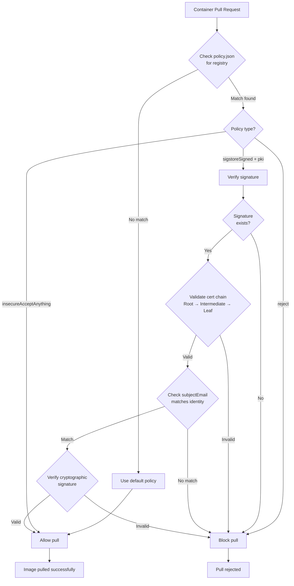

# CRI-O BYO-PKI Signature Verification

<!-- markdownlint-configure-file { "MD013": { "tables": false } } -->

Runtime signature verification using CRI-O's native `containers/image` library
with X.509 certificate chains.

Legacy cosign signatures only: the library cannot read Sigstore bundles, the
only format in cosign v4
([container-libs#388](https://github.com/podman-container-tools/container-libs/issues/388)).
Run it in a VM with `make -C ../vm crio`.

## Requirements

- **CRI-O 1.34+** (requires [containers/image
  v5.34.1+](https://github.com/containers/image/pull/2557) for `pki` field,
  released 2025-02-28)
- Ubuntu 24.04 VM with sudo

Check version: `crio --version | grep GitCommitDate` (must be after 2025-02-28)

## Quick Start

```bash
make setup    # Install CRI-O 1.34, k8s, docker, cosign (requires reboot)
# <reboot>
make run      # Auto-init k8s, sign images, run tests
make test-v2  # Test only v2 signatures
make clean    # Reset everything
```

## How It Works

### Policy (`/etc/containers/policy.json`)

```json
{
  "default": [{"type": "insecureAcceptAnything"}],
  "transports": {
    "docker": {
      "127.0.0.1:5003": [{
        "type": "sigstoreSigned",
        "pki": {
          "caRootsPath": "/etc/containers/certs/ca-roots.pem",
          "caIntermediatesPath": "/etc/containers/certs/ca-intermediates.pem",
          "subjectEmail": "ci-build@example.com"
        },
        "signedIdentity": {
          "type": "matchRepository"
        }
      }],
      "127.0.0.1:5002": [{"type": "insecureAcceptAnything"}],
      "gcr.io": [{"type": "reject"}]
    }
  }
}
```

**4 scenarios:**

- `127.0.0.1:5003`: **VERIFY** with BYO-PKI certificate chain
- `127.0.0.1:5002`: **ALLOW** without verification
- `gcr.io`: **BLOCK** explicitly
- `default`: **ALLOW** (docker.io, registry.k8s.io, etc.)

### Verification Flow



**Steps:**

1. CRI-O checks `/etc/containers/policy.json` for registry match
1. If `sigstoreSigned` with `pki`, validates:
   - Certificate chain: Root CA → Intermediate CA → Leaf
   - Certificate identity: `subjectEmail` matches `ci-build@example.com`
   - Cryptographic signature
1. Pulls image if all checks pass, rejects otherwise

### Why BYO-PKI?

- Standard X.509 PKI (no Fulcio/Rekor dependency)
- Works air-gapped
- Integrates with organizational PKI
- Certificate expiration handling built-in

## Testing

The test suite runs 5 tests at CRI level and 2 at Kubernetes level:

```bash
# CRI level tests
sudo crictl pull 127.0.0.1:5003/alpine:3.20.3    # Test 1: signed → OK
sudo crictl pull 127.0.0.1:5003/alpine:unsigned  # Test 2: unsigned → FAIL
sudo crictl pull 127.0.0.1:5003/bundle-only:3.20.3  # Test 5: bundle only → FAIL

# Kubernetes level tests
kubectl apply -f manifests/signed-pod.yaml       # Test 3: → Running
kubectl apply -f manifests/unsigned-pod.yaml     # Test 4: → ImagePullBackOff
```

Test 5 is a tripwire: `make sign-image-bundle-only` signs the image with a
Sigstore bundle alone, without cosign, through
`../cosign-v4-pre/sign-offline.sh` and this directory's PKI, and asserts
that `cosign verify` accepts it. CRI-O must fail the pull with
`A signature was required, but no signature exists`, as for an unsigned
image; a CRI-O that reads bundles fails the test.

**Note:** While the policy configures 4 scenarios (primary registry verify,
secondary registry allow, gcr.io block, default allow), the test suite focuses
on the primary registry verification scenarios.

## Config Details

**Registries.d** (`/etc/containers/registries.d/default.yaml`):

```yaml
docker:
  127.0.0.1:5003:
    use-sigstore-attachments: true
  localhost:5003:
    use-sigstore-attachments: true
```

Tells CRI-O to look for signatures as [OCI
artifacts](https://github.com/sigstore/cosign/blob/main/specs/SIGNATURE_SPEC.md#oci-artifacts).

**Certificate Chain** (`examples/`):

```text
ca.crt (Root CA)
  └── sub-ca.crt (Intermediate CA)
        └── leaf.crt (Signing cert with email:ci-build@example.com)
```

Generated by `scripts/gencrt.sh`.

## Troubleshooting

**"pki: no such configuration field"** → CRI-O too old. Need 1.34+ with
containers/image v5.34.1+ ([PR#2557](https://github.com/containers/image/pull/2557))

**All images rejected** → Check policy allows `registry.k8s.io`, `docker.io`,
etc. in `default`

**Signature verification failed on signed image** → Check logs:

```shell
sudo journalctl -u crio | grep -i signature`
# Verify cert chain:
openssl verify -CAfile examples/ca.crt -untrusted examples/sub-ca.crt \
    examples/leaf.crt
# Check email:
openssl x509 -in examples/leaf.crt -noout -text | \
    grep -A2 "Subject Alternative Name"
```

## References

- [containers/image pki
  field](https://github.com/containers/image/blob/main/docs/containers-policy.json.5.md#sigstoresigned)
  - policy.json documentation
- [PR #2557](https://github.com/containers/image/pull/2557) - pki field
  implementation (2025-02-28)
- [CRI-O sigstore
  tutorial](https://github.com/cri-o/cri-o/blob/main/tutorials/sigstore.md)

<!-- cSpell:ignore fulcio,rekor,journalctl,crio,noout,sigstore -->
