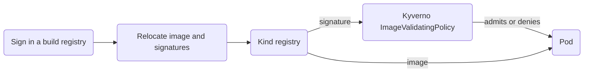

<!-- cSpell:ignore kyverno,oras,notation,sigstore,tlog -->

# Admission-time verification with Kyverno

Kyverno `ImageValidatingPolicy` rejects pods whose images are not signed by the
configured private CA. Kyverno 1.20 no longer runs `kyverno.io` `ClusterPolicy`,
so the policies use `policies.kyverno.io/v1`. The chart version is pinned in
`Makefile`.



Each flow signs in its own registry, relocates the signed image with its
signatures into the Kind registry, applies the policy, and asserts that the
unsigned pod and deployment are denied while the signed ones are admitted and
run.

| Flow | Signed by | Relocated with | Policy |
| -- | -- | -- | -- |
| `cosign-v2.mk` | [../cosign-v2](../cosign-v2/README.md) | `cosign save`, `cosign load` | `policy/kyverno-policy-cosign.yaml` |
| `cosign-v3.mk` | [../cosign-v3](../cosign-v3/README.md) | `cosign save`, `cosign load` | `policy/kyverno-policy-cosign.yaml` |
| `notation.mk` | [../notation](../notation/README.md) | `oras cp` via OCI layout tarball | `policy/kyverno-policy-notation.yaml` |

```bash
make setup               # Kind cluster, registry, Kyverno; rerunnable
make -f cosign-v2.mk
make -f cosign-v3.mk
make -f notation.mk
make clean
```

The top-level `make cosign-v2`, `make cosign-v3` and `make notation` run setup
plus the flow.

## Notes

- Both cosign flows verify legacy signatures (`.sig` tag, simple signing
  payload). The CA is the root only; the intermediate travels with the
  signature.
- Workloads reference `kind-registry:5000`, which both the Kind nodes and the
  Kyverno pod resolve. `scripts/kind-cluster.sh` maps it to plain http in
  containerd, and Kyverno runs with `--allowInsecureRegistry`.
- The PEM block in each policy is a placeholder replaced with the flow's
  generated CA by `common.mk`.
- Sigstore bundles from [../cosign-v4-pre](../cosign-v4-pre/README.md) are not
  admissible with a private CA and no timestamp authority, see that README.
