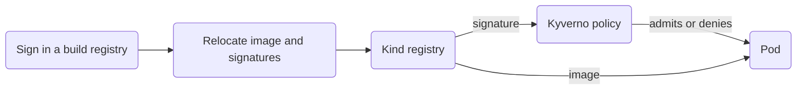

<!-- cSpell:ignore kyverno,oras,notation,sigstore,tlog,referrers -->
<!-- markdownlint-configure-file { "MD013": { "tables": false } } -->

# Admission-time verification with Kyverno

Kyverno rejects pods whose images are not signed by the configured private
CA. Each signing directory, its suite, has its own Kind cluster,
`kyverno-<suite>`, with its own registries and Kyverno version, so no flow
touches another suite's cluster; the bundle flows share
`kyverno-cosign-v4-pre`. A flow names its suite as `SUITE`; versions,
charts and ports are in `cluster.mk`. The two versions:

- 1.19 (chart 3.9.2), the last release that runs the legacy `kyverno.io`
  `ClusterPolicy` with `verifyImages`, for the legacy signature flows: the
  legacy policy alone, the `policies.kyverno.io` `ImageValidatingPolicy`
  alone, and both together.
- 1.20 (chart 3.10.0), which refuses to create a `ClusterPolicy` and runs
  only `ImageValidatingPolicy`, for Notation and every bundle flow.

Every flow runs `make setup` itself, which creates its suite's cluster if
missing, and starts from its own policies only.



Each flow signs in its own registry, relocates the signed image with its
signatures into the Kind registry, applies its policies, and asserts that the
unsigned pod and deployment, an unsigned init container and an unsigned
`kubectl debug` ephemeral container are denied while the signed ones are
admitted and run; `cosign-v3.mk` asserts the exception below.

| Flow | Kyverno | Signed by | Relocated with | Policies in `policy/` |
| -- | -- | -- | -- | -- |
| `cosign-v2.mk` | 1.19 | [../cosign-v2](../cosign-v2/README.md) | `cosign save`, `cosign load` | `kyverno-policy-cosign-legacy.yaml` |
| `cosign-v3.mk` | 1.19 | [../cosign-v3](../cosign-v3/README.md) | `cosign save`, `cosign load` | `kyverno-policy-cosign-legacy.yaml`, `kyverno-policy-cosign.yaml`, alone and together |
| `notation.mk` | 1.20 | [../notation](../notation/README.md) | `oras cp` via OCI layout tarball | `kyverno-policy-notation.yaml` |
| `cosign-v4-pre.mk` | 1.20 | [../cosign-v4-pre](../cosign-v4-pre/README.md) `v4-tsa`, or `v4-rsa` with `SIGN_TARGET=v4-rsa` | `oras cp -r` via OCI layout tarball | `kyverno-policy-bundle.yaml` |
| `bundle-dev.mk` | 1.20 | `v4-dev-signatures` | same | same |
| `bundle-zot.mk` | 1.20 | `v4-referrers`, into the cluster's zot | same | same |
| `bundle-shapes.mk` | 1.20 | `v4-shapes` | same | same |
| `bundle-multiarch.mk` | 1.20 | `v4-multiarch` | same | same |
| `bundle-expiry.mk` | 1.20 | `v4-leaf-expiry` | same | same |
| `bundle-binding.mk` | 1.20 | `v4-repo-binding` | same | `kyverno-policy-bundle-repository.yaml` |
| `bundle-devcerts.mk` | 1.20 | `v4-devcerts`, the EPPKI C1 dev kit in `DEVCERTS` | same | `kyverno-policy-bundle.yaml` |

Each flow adds its own assertions after the common ones:

| Flow | Asserts |
| -- | -- |
| `cosign-v2.mk` | the unsigned pod is denied by the `ClusterPolicy`, and the signed pod carries its `verifyImages` pass in `kyverno.io/verify-images-scoped`, which only that path writes |
| `cosign-v3.mk` | three modes, `MODES=legacy new both` by default. `legacy` as `cosign-v2.mk`. `new`: denied by the `ImageValidatingPolicy`, passed in the policy report, no `verifyImages` annotation. `both`: both policies enforce at once; the signed pod passes both, in the annotation and in the policy report, and the unsigned pod is denied by whichever webhook runs first |
| `cosign-v4-pre.mk` | the admitted pod runs `tag@digest`; with `DIGEST=false`, `mutateDigest` and `verifyDigest` off, it runs the tag reference as given |
| `bundle-dev.mk` | an image with a development and a production bundle is admitted by a trusted root holding the production CA alone; the development bundle alone is denied with `failed to verify leaf certificate` |
| `bundle-zot.mk` | admitted from zot, which holds no fallback tag: Kyverno found the bundle through the referrers API |
| `bundle-shapes.mk` | tripwire: leaf plus intermediate denied with `no signatures found`, leaf without timestamp with `threshold not met for verified signed timestamps`; a legacy signature by the same PKI, without timestamp and without bundle, admitted, as Kyverno verifies legacy signatures when it finds no bundle |
| `bundle-multiarch.mk` | Kyverno verifies the digest the pod names. A bundle on the index admits the tag and not a platform digest; bundles on the platform manifests admit a platform digest and not the tag |
| `bundle-expiry.mk` | a timestamped bundle is admitted after its signing leaf has expired |
| `bundle-devcerts.mk` | the kit's valid certificate admitted with its SAN pinned, and the one its CRL revokes too, as no CRL is read; the expired one and the one of the revoked `SubCA_C1_dev_5`, which the trusted root lacks, denied with `failed to verify leaf certificate` |
| `bundle-binding.mk` | one policy per repository requires its signed `repository` annotation: `bundle/app` is admitted, the same image and bundle copied to `bundle/other` denied with `missing or incorrect annotation`, the copy's certificate swapped for the `other` one too |

```bash
make setup SUITE=cosign-v2  # its cluster, registries, Kyverno; flows run it
make -f cosign-v2.mk
make -f cosign-v3.mk     # also MODES=both
make -f notation.mk
make -f cosign-v4-pre.mk # also SIGN_TARGET=v4-rsa, DIGEST=false
make -f bundle-dev.mk    # likewise bundle-zot.mk, bundle-shapes.mk, bundle-multiarch.mk,
                         # bundle-expiry.mk, bundle-binding.mk
make -f bundle-devcerts.mk DEVCERTS=/abs/kit  # the EPPKI C1 dev kit
make -f cosign-v2.mk CERT_SCRIPT=../cosign-v4-pre/devcerts.sh DEVCERTS=/abs/kit
make api-versions        # ClusterPolicy refused, ImageValidatingPolicy versions
make clean
```

The top-level `make cosign-v2`, `make cosign-v3`, `make notation` and
`make cosign-v4-pre` run the flows; `make cosign-v4-pre` runs every bundle
flow.

## API version

The `ImageValidatingPolicy` files here use `policies.kyverno.io/v1`, the
non-beta version; Kyverno 1.19.2 serves it too.
Kyverno 1.20.0 serves `ImageValidatingPolicy` as `v1` and `v1beta1`, with one
schema, no conversion webhook, and `v1beta1` as storage version, so `v1` and
`v1beta1` policies are interchangeable on 1.20; `container-encryption-poc`
writes `v1beta1`.
`make api-versions` asserts this, and that 1.20 refuses to create a
`kyverno.io` `ClusterPolicy`.

## From ClusterPolicy verifyImages

[policy/kyverno-policy-cosign-legacy.yaml](policy/kyverno-policy-cosign-legacy.yaml)
is the Cosign `ClusterPolicy`, run by the 1.19 flows;
[policy/kyverno-policy-cosign.yaml](policy/kyverno-policy-cosign.yaml)
replaces it.

| `ClusterPolicy` (`kyverno.io/v2beta1`) | `ImageValidatingPolicy` (`policies.kyverno.io/v1`) |
| -- | -- |
| `validationFailureAction: Enforce` | `validationActions: [Deny]` |
| `webhookTimeoutSeconds` | `webhookConfiguration.timeoutSeconds` |
| `failurePolicy` | `failurePolicy` |
| `rules[].match.any[].resources.kinds: [Pod]` | `matchConstraints.resourceRules`: pods, `CREATE` and `UPDATE`, plus `pods/ephemeralcontainers`, which the `ClusterPolicy` matches implicitly; the reports controller must be granted read on it, or the policy never becomes ready (`Makefile` `install-kyverno`). On 1.19 it turns autogen off, so `kyverno-policy-cosign.yaml` leaves it out, and `cosign-v3.mk` asserts that this policy alone admits an unsigned ephemeral container |
| `verifyImages[].imageReferences` | `matchImageReferences[].glob` |
| `verifyImages[].type: Cosign`, `SigstoreBundle` | `attestors[].cosign`, for legacy signatures and bundles alike |
| `verifyImages[].type: Notary` | `attestors[].notary` |
| `attestors[].entries[].certificates.certChain` | `attestors[].cosign.certificate.certChain.value` |
| `attestors[].entries[].certificates.cert` (Notary) | `attestors[].notary.certs.value` |
| `certificates.rekor.ignoreTlog`, `certificates.ctlog.ignoreSCT` | `cosign.ctlog.insecureIgnoreTlog`, `cosign.ctlog.insecureIgnoreSCT` |
| `attestors[].count`, `entries` | the CEL `validations[].expression`, here `verifyImageSignatures(image, [attestors.cosign]) > 0` for every container |
| containers, init containers and ephemeral containers, all verified | `images.containers` holds containers only; the expression adds `images.initContainers` and `images.ephemeralContainers` |
| `verifyImages[].mutateDigest`, `verifyDigest`, `required` | `validationConfigurations.mutateDigest`, `verifyDigest`, `required`, each defaulting to `true` |
| rules generated for Pod controllers | `autogen`, on by default: the unsigned deployment is denied in every flow |

The bundle policy pins the signer: `keyless.identities[].subject` is the
leaf's URI SAN, `SUBJECT` of `common.mk`, and `issuerRegExp: "^$"`, as a
private PKI certificate carries no Fulcio OIDC issuer extension and its
issuer is empty; a Fulcio certificate under the same root would not match.

The bundle policy, [policy/kyverno-policy-bundle.yaml](policy/kyverno-policy-bundle.yaml),
has no counterpart here: it uses `attestors[].cosign.keyless` with an inline
`trustedRoot.value`.

## Notes

- Both cosign flows verify legacy signatures (`.sig` tag, simple signing
  payload). The CA is the root only; the intermediate travels with the
  signature. Cosign v4 removes that format, and Kyverno 1.20 the
  `ClusterPolicy` that verified it; `cosign-v3.mk MODES=both` is the
  migration step, both policies enforcing until the legacy one is removed.
- Bundles are admitted only as leaf-only bundle plus signed timestamp, with
  the CA chain and the timestamp authority in the policy's inline trusted
  root, see [../cosign-v4-pre](../cosign-v4-pre/README.md).
- Each cluster has a `registry:3`, `<cluster>-registry`; the bundle cluster
  also has zot, `<cluster>-zot`. They are referenced by their kind network
  IPs, and `make setup` restarts a cluster's registries empty.
  Kyverno's bundle fetch ignores `--allowInsecureRegistry`, and
  go-containerregistry falls back to http only for private IPs, not container
  names. `scripts/kind-cluster.sh` maps the IPs to plain http in containerd.
- `__TRUST__` in each policy is replaced with the flow's root CA or trusted
  root by `common.mk`, `__DIGEST__` in the bundle policy with `DIGEST`.
- Every kubectl and helm call names the cluster's context,
  `kind-kyverno-<suite>`, and cluster creation restores the previous current
  context.
