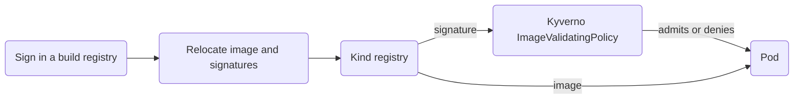

<!-- cSpell:ignore kyverno,oras,notation,sigstore,tlog,referrers -->
<!-- markdownlint-configure-file { "MD013": { "tables": false } } -->

# Admission-time verification with Kyverno

Kyverno `ImageValidatingPolicy` rejects pods whose images are not signed by the
configured private CA. Kyverno 1.20 no longer runs `kyverno.io` `ClusterPolicy`,
so the policies use `policies.kyverno.io/v1`, see [API version](#api-version).
The chart version is pinned in `Makefile`.



Each flow signs in its own registry, relocates the signed image with its
signatures into the Kind registry, applies the policy, and asserts that the
unsigned pod and deployment are denied while the signed ones are admitted and
run.

| Flow | Signed by | Relocated with | Policy |
| -- | -- | -- | -- |
| `cosign-v2.mk` | [../cosign-v2](../cosign-v2/README.md) | `cosign save`, `cosign load` | `policy/kyverno-policy-cosign.yaml` |
| `cosign-v3.mk` | [../cosign-v3](../cosign-v3/README.md) | `cosign save`, `cosign load` | `policy/kyverno-policy-cosign.yaml` |
| `notation.mk` | [../notation](../notation/README.md) | `oras cp` via OCI layout tarball | `policy/kyverno-policy-notation.yaml` |
| `cosign-v4-pre.mk` | [../cosign-v4-pre](../cosign-v4-pre/README.md) `v4-tsa`, or `v4-rsa` with `SIGN_TARGET=v4-rsa` | `oras cp -r` via OCI layout tarball | `policy/kyverno-policy-bundle.yaml` |
| `bundle-dev.mk` | `v4-dev-signatures` | same | same |
| `bundle-zot.mk` | `v4-referrers`, into `kind-zot` | same | same |
| `bundle-shapes.mk` | `v4-shapes` | same | same |
| `bundle-multiarch.mk` | `v4-multiarch` | same | same |
| `bundle-expiry.mk` | `v4-leaf-expiry` | same | same |

Each bundle flow adds its own assertions after the common ones:

| Flow | Asserts |
| -- | -- |
| `cosign-v4-pre.mk` | the admitted pod runs `tag@digest`; with `DIGEST=false`, `mutateDigest` and `verifyDigest` off, it runs the tag reference as given |
| `bundle-dev.mk` | an image with a development and a production bundle is admitted by a trusted root holding the production CA alone; the development bundle alone is denied with `failed to verify leaf certificate` |
| `bundle-zot.mk` | admitted from zot, which holds no fallback tag: Kyverno found the bundle through the referrers API |
| `bundle-shapes.mk` | tripwire: leaf plus intermediate denied with `no signatures found`, leaf without timestamp with `threshold not met for verified signed timestamps` |
| `bundle-multiarch.mk` | Kyverno verifies the digest the pod names. A bundle on the index admits the tag and not a platform digest; bundles on the platform manifests admit a platform digest and not the tag |
| `bundle-expiry.mk` | a timestamped bundle is admitted after its signing leaf has expired |

```bash
make setup               # Kind cluster, registries, Kyverno; rerunnable
make -f cosign-v2.mk
make -f cosign-v3.mk
make -f notation.mk
make -f cosign-v4-pre.mk # also SIGN_TARGET=v4-rsa, DIGEST=false
make -f bundle-dev.mk    # likewise bundle-zot.mk, bundle-shapes.mk, bundle-multiarch.mk,
                         # bundle-expiry.mk
make api-versions        # ClusterPolicy refused, ImageValidatingPolicy versions
make clean
```

The top-level `make cosign-v2`, `make cosign-v3`, `make notation` and
`make cosign-v4-pre` run setup plus the flows; `make cosign-v4-pre` runs every
bundle flow, each after a fresh `make setup`.

## API version

The policies here use `policies.kyverno.io/v1`, the non-beta version.
Kyverno 1.20.0 serves `ImageValidatingPolicy` as `v1` and `v1beta1`, with one
schema, no conversion webhook, and `v1beta1` as storage version, so `v1` and
`v1beta1` policies are interchangeable on 1.20; `container-encryption-poc`
writes `v1beta1`.
`make api-versions` asserts this, and that 1.20 refuses to create a
`kyverno.io` `ClusterPolicy`.

## From ClusterPolicy verifyImages

[policy/legacy-clusterpolicy.yaml](policy/legacy-clusterpolicy.yaml) is the
former Cosign policy; [policy/kyverno-policy-cosign.yaml](policy/kyverno-policy-cosign.yaml)
replaces it.

| `ClusterPolicy` (`kyverno.io/v2beta1`) | `ImageValidatingPolicy` (`policies.kyverno.io/v1`) |
| -- | -- |
| `validationFailureAction: Enforce` | `validationActions: [Deny]` |
| `webhookTimeoutSeconds` | `webhookConfiguration.timeoutSeconds` |
| `failurePolicy` | `failurePolicy` |
| `rules[].match.any[].resources.kinds: [Pod]` | `matchConstraints.resourceRules`: pods, `CREATE` and `UPDATE` |
| `verifyImages[].imageReferences` | `matchImageReferences[].glob` |
| `verifyImages[].type: Cosign`, `SigstoreBundle` | `attestors[].cosign`, for legacy signatures and bundles alike |
| `verifyImages[].type: Notary` | `attestors[].notary` |
| `attestors[].entries[].certificates.certChain` | `attestors[].cosign.certificate.certChain.value` |
| `attestors[].entries[].certificates.cert` (Notary) | `attestors[].notary.certs.value` |
| `certificates.rekor.ignoreTlog`, `certificates.ctlog.ignoreSCT` | `cosign.ctlog.insecureIgnoreTlog`, `cosign.ctlog.insecureIgnoreSCT` |
| `attestors[].count`, `entries` | the CEL `validations[].expression`, here `verifyImageSignatures(image, [attestors.cosign]) > 0` for every container |
| `verifyImages[].mutateDigest`, `verifyDigest`, `required` | `validationConfigurations.mutateDigest`, `verifyDigest`, `required`, each defaulting to `true` |
| rules generated for Pod controllers | `autogen`, on by default: the unsigned deployment is denied in every flow |

The bundle policy, [policy/kyverno-policy-bundle.yaml](policy/kyverno-policy-bundle.yaml),
has no counterpart here: it uses `attestors[].cosign.keyless` with an inline
`trustedRoot.value`.

## Notes

- Both cosign flows verify legacy signatures (`.sig` tag, simple signing
  payload). The CA is the root only; the intermediate travels with the
  signature.
- Bundles are admitted only as leaf-only bundle plus signed timestamp, with
  the CA chain and the timestamp authority in the policy's inline trusted
  root, see [../cosign-v4-pre](../cosign-v4-pre/README.md).
- The registries are `kind-registry`, `registry:3`, and `kind-zot`, zot,
  referenced by their kind network IPs; `make setup` restarts both empty.
  Kyverno's bundle fetch ignores `--allowInsecureRegistry`, and
  go-containerregistry falls back to http only for private IPs, not container
  names. `scripts/kind-cluster.sh` maps the IPs to plain http in containerd.
- `__TRUST__` in each policy is replaced with the flow's root CA or trusted
  root by `common.mk`, `__DIGEST__` in the bundle policy with `DIGEST`.
- Every kubectl and helm call uses the `kind-kyverno` context, and cluster
  creation restores the previous current context.
